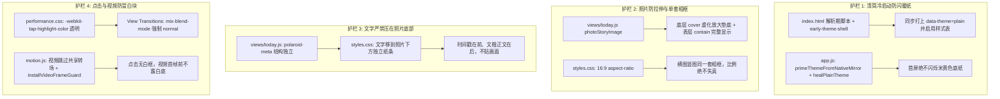
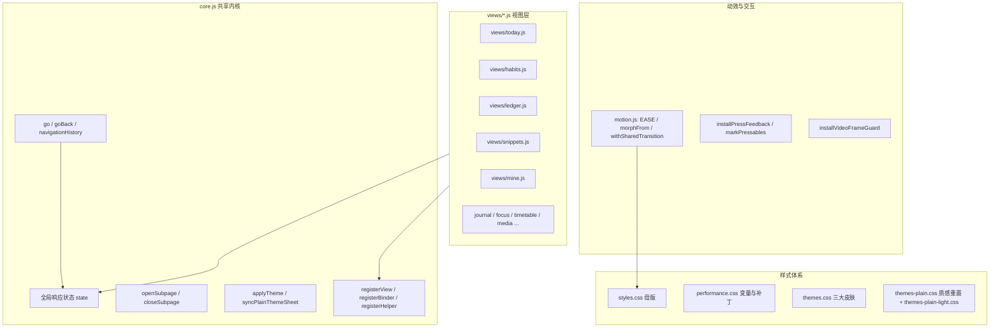

# 前端全方位代码分析与质量评估报告

> **报告版本**：2026-10 深度全量重构版  
> **评估模型**：gemini-3.8-flash-high  
> **项目名称**：mine-warmjournal (暖色生活志 · 纸张画报系统)  
> **评估基准**：`VISUAL_RULES.md`（暖色纸张画报系统宪法）、`PROJECT_MAP.md`（项目地图与工程架构）  
> **代码版本基线**：v1.1.9 (versionCode 110 / commit `37a1f54`)  
> **分析模式**：只读静态代码深度审计，未修改任何已有源码及文档  
> **核心原则**：严格锚定已合入 `main` 的四大不可退步硬性护栏，绝不允许回退。

---

## 目录

1. [四大不可退步硬性护栏（技术机制与防回退核对）](#一四大不可退步硬性护栏技术机制与防回退核对)
2. [项目前端总体架构概览](#二项目前端总体架构概览)
3. [维度一：信息架构与导航 (IA / Nav)](#三维度一信息架构与导航-ia--nav)
4. [维度二：视觉与主题 (Visual / Theme，重点 Plain 清简主题)](#四维度二视觉与主题-visual--theme重点-plain-清简主题)
5. [维度三：交互动效 (Interaction / Motion)](#五维度三交互动效-interaction--motion)
6. [维度四：性能瓶颈 (Performance)](#六维度四性能瓶颈-performance)
7. [维度五：代码结构与可维护性 (Code Structure)](#七维度五代码结构与可维护性-code-structure)
8. [维度六：无障碍与中文化 (a11y / Chinese)](#八维度六无障碍与中文化-a11y--chinese)
9. [维度七：潜在 Bug 与边界隐患 (Latent Bugs)](#九维度七潜在-bug-与边界隐患-latent-bugs)
10. [综合改进路线图与工程建议](#十综合改进路线图与工程建议)

---

## 一、四大不可退步硬性护栏（技术机制与防回退核对）

在近期的主干演进中（PR #3、PR #5、PR #6、PR #7 及版本 1.1.9），项目修复了四个极其关键的用户体验痛点。这四条防线已全部合入 `main`，是后续任何重构、动效优化与主题定制必须坚守的**零级底线（P0 Guardrails）**。



### 1.1 护栏 1 · 清简（plain）主题冷启动不得先闪一下暖色纸
- **核心文件**：[index.html:28-90](file:///workspace/mine-warmjournal/index.html#L28-L90)、[app.js:200-245](file:///workspace/mine-warmjournal/app.js#L200-L245)、[core.js:263-349](file:///workspace/mine-warmjournal/core.js#L263-L349)、[tests/theme-skins.test.mjs](file:///workspace/mine-warmjournal/tests/theme-skins.test.mjs)
- **成因与历史教训**：经典主题依赖米黄宣纸纹理，而清简主题主色调为冷雾蓝白（`#EAF0F8`）。旧版本中，主题配置存放在异步 SQLite 存储中，WebView 冷启动时先行加载经典主题背景，等存储读完后才切换为清简，导致用户在启动时必然遭遇 100~300ms 的「先闪米黄纸、再变冷白」刺眼跳闪。
- **已合入 main 的防护架构**：
  1. **首屏保护壳**：[index.html:28-44](file:///workspace/mine-warmjournal/index.html#L28-L44) 注入内联 `<style id="early-theme-shell">`，明确定义 `html[data-theme="plain"]`、`html.theme-pending` 的底色强制为 `#EAF0F8` / `#f4f5f6`，且 `background-image: none !important;`。
  2. **解析期同步侦测**：[index.html:45-90](file:///workspace/mine-warmjournal/index.html#L45-L90) 在 DOM 解析的最早期阶段同步读取 `localStorage` 短键 `mine-warmjournal-theme`、同名 Cookie、或正则轻量扫描状态字符串（绝不 `JSON.parse` 几 MB 字符串）。一旦命中 `plain`，立即设置 `root.setAttribute('data-theme', 'plain')`，并同步启用 `<link id="plain-theme-sheet">`（移除 `disabled`，设置 `media="all"`）。若处于 Android WebView 环境且首屏尚未读到主题，打上 `theme-pending` 先隐藏外壳，等原生存储确认。
  3. **原生存储镜像注入**：[core.js:339-349](file:///workspace/mine-warmjournal/core.js#L339-L349) 的 `primeThemeFromNativeMirror` 在数据库初始化前优先读取 Filesystem/Preferences 镜像。
  4. **运行期自愈防刷新**：[app.js:200-235](file:///workspace/mine-warmjournal/app.js#L200-L235) 的 `healPlainTheme` 放弃了旧版的 `location.reload()` 暴力重启（重载会引发二次闪烁），改为纯 DOM 动态纠偏。
- **防回退审查红线**：禁止将 `index.html` 的解析期脚本迁移到异步包中；禁止删除 `early-theme-shell`；禁止将 `plain-theme-sheet` 改为全局常驻加载或延迟挂载。

### 1.2 护栏 2 · 照片不得拉伸；横图竖图用同一套相框处理，不要分两套
- **核心文件**：[views/today.js:130-141](file:///workspace/mine-warmjournal/views/today.js#L130-L141)、[styles.css:8860-8910](file:///workspace/mine-warmjournal/styles.css#L8860-L8910)、[tests/today-editorial-functionality.test.mjs](file:///workspace/mine-warmjournal/tests/today-editorial-functionality.test.mjs)
- **成因与历史教训**：过去今日画页曾试图针对横版照片与竖版照片分别设计两套不同的留白比例与容器样式。这不仅导致代码分支冗余，更在竖图装载时偶发比例计算错误，使得用户拍摄的竖屏照片被压扁或拉长；横图与竖图交替滑动时相框高度剧烈跳变。
- **已合入 main 的防护架构**：
  1. **统一双层相框渲染器**：[views/today.js:135-138](file:///workspace/mine-warmjournal/views/today.js#L135-L138) 的 `photoStoryImage(source, alt)`，与随手拍（Moments）完全共用一套相框机制。
  2. **16:9 黄金视窗 + 虚化垫底**：相框 `.polaroid-frame` 固定 `aspect-ratio: 16/9`。容器内包含两层同一图片：
     - 底层 `img.polaroid-blur`：`object-fit: cover`，放大并叠加 `filter: blur(18px) saturate(1.12)` 柔和铺满；
     - 表层 `img.polaroid-img`：`object-fit: contain`，完整居中悬浮，绝不拉伸。
  3. **零重复下载开销**：两层指向完全一致的 URL，浏览器内核只解码一次。横图与竖图在这个容器内均能完美自适应，横图饱满居中，竖图左右自然露出品质虚化背景。
- **防回退审查红线**：禁止恢复针对横图/竖图拆分条件分支的 CSS；禁止修改表层图片的 `object-fit: contain`；禁止使用非等比的强制拉伸样式。

### 1.3 护栏 3 · 文字不得压在照片底部
- **核心文件**：[views/today.js:129](file:///workspace/mine-warmjournal/views/today.js#L129)、[styles.css:8915-8985](file:///workspace/mine-warmjournal/styles.css#L8915-L8985)
- **成因与历史教训**：早期版本将拍摄时间与心情手写文字以蒙层（Overlay）形式直接压在照片画面的下半截。在浅色照片、高反差纹理或复杂背景图上，文字完全无法看清；更严重的是，文字直接破坏了拍立得相片的纯净感，遮挡了画面主体。
- **已合入 main 的防护架构**：
  1. **结构解耦**：照片本体 `.polaroid-frame` 与文字信息 `.polaroid-meta` 在 DOM 结构上彻底分离，成为上下排列的兄弟节点。
  2. **移入下方纸条**：文字移至相框下方的实体纸面，排版上 `.polaroid-time` 在前（10px 紧凑时间戳），手写感正文 `.polaroid-caption` 在后（15px 霞鹜文楷，最多 2 行 clamp，行高 1.4）。
  3. **色彩与阴影微调**：文字配有轻微暖色投影 `text-shadow: 0 1px 0 rgba(255,248,232,.75)`（清简主题下为纯净深墨色无投影），彻底脱离画面背景的色彩干扰。
- **防回退审查红线**：禁止将 `.polaroid-meta` 重新设置为绝对定位悬浮在照片内部；禁止移除正文的 `-webkit-line-clamp: 2` 截断保护。

### 1.4 护栏 4 · 点击 / 打开视频不得冒出白块（转场、点击高亮、弹层、首帧白底已通盘治理）
- **核心文件**：[motion.js:145-219](file:///workspace/mine-warmjournal/motion.js#L145-L219)、[motion.js:358-397](file:///workspace/mine-warmjournal/motion.js#L358-L397)、[performance.css:124](file:///workspace/mine-warmjournal/performance.css#L124)、[performance.css:4315-4337](file:///workspace/mine-warmjournal/performance.css#L4315-L4337)、[capacitor.config.json](file:///workspace/mine-warmjournal/capacitor.config.json)
- **成因与历史教训**：
  - Android WebView 原生点击默认附带灰色/白色点击高亮；
  - 浏览器 View Transitions API 默认使用 `mix-blend-mode: plus-lighter` 加色混合，浅色卡片在转场形变时会被加权为纯白强光；
  - `<video>` 元素在首帧解码完毕前，Android 原生渲染管线会先行涂抹一块白色矩形，且该白底无法被普通 CSS 背景覆盖；若在转场中将 `<video>` 作为共享元素，快照拍下的就是一块突兀的白斑。
- **已合入 main 的防护架构**：
  1. **全局高亮消除**：[performance.css:124](file:///workspace/mine-warmjournal/performance.css#L124) 明确 `button, a { -webkit-tap-highlight-color: rgba(0, 0, 0, 0); }`。
  2. **混合模式与转场底色锁定**：[performance.css:4315-4337](file:///workspace/mine-warmjournal/performance.css#L4315-L4337) 强制 `::view-transition { background: var(--canvas, #f5f1e8); }`，并对所有过渡组与快照声明 `mix-blend-mode: normal;`，根快照取消淡化动画，杜绝加色白光。
  3. **视频元素转场熔断**：[motion.js:147](file:///workspace/mine-warmjournal/motion.js#L147) 与 [motion.js:195-204](file:///workspace/mine-warmjournal/motion.js#L195-L204) 中，凡是源元素或目标落点为 `<video>` 的，立即清空 `viewTransitionName` 并调用 `transition.skipTransition()`，只放大照片，绝不抓取视频过渡快照。
  4. **视频帧守卫拦截器**：[motion.js:358-397](file:///workspace/mine-warmjournal/motion.js#L358-L397) 部署 `installVideoFrameGuard()`，通过 MutationObserver 自动捕获新插入的 `<video>`，在未触发 `loadeddata`/`canplay` 前打上 `.is-awaiting-frame` 类将其视觉隐藏，首帧抵达后再揭开，平滑过渡。
- **防回退审查红线**：禁止在视频播放入口复用共享元素转场；禁止修改 View Transition 的 `mix-blend-mode: normal`；禁止移除全局 tap-highlight 透明度声明。

---

## 二、项目前端总体架构概览

本项目坚守 **Vanilla ES Modules + 原生 Web 标准**，依托 Capacitor 8.5.0 打包为 Android 原生应用。



- **状态管理与控制反转**：采用极薄的 Service Locator 模式，`core.js` 作为地基，通过 `registerView`、`registerBinder`、`registerSubmitHandler` 与 `registerHelper` 实现视图模块的自注册。
- **渲染驱动模式**：采用声明式模板字符串拼接与全量挂载（`$('#app').innerHTML = resolveView(state.route)()`），每次渲染后广播触发所有 `binders`。
- **视觉多轨支持**：经典暖色（classic）、暖阳（sunny）与清简（plain），其中清简主题由 `themes.css` 变量层 + `themes-plain.css` 质感重置层联合驱动。

---

## 三、维度一：信息架构与导航 (IA / Nav)

### 3.1 [P0] 日记过往篇章点击跳转脱离创作上下文
- **文件路径与大致行号**：[views/journal.js:632](file:///workspace/mine-warmjournal/views/journal.js#L632)、[app.js:140-141](file:///workspace/mine-warmjournal/app.js#L140-L141)
- **现状与成因**：
  在日记主视图下方展示了「过往篇章」列表，每个项带有属性 `data-open-journal="${entry.date}"`。然而在 `app.js` 的全局委托监听中：
  ```javascript
  const openJournal = event.target.closest('[data-open-journal]');
  if (openJournal) { const day = openJournal.dataset.openJournal; closeModal(); go('calendar', day); }
  ```
  该逻辑将用户直接跳转至日历视图（`calendar` 路由）。日历是一个按月日程排布的网格体系，用户在日记里点击过往记录是期望「翻阅那篇日记」或「切换到那天的日记继续编辑」，被强行甩到日历网格会产生极强的操作挫败感。
- **建议修复**：
  在 `views/journal.js` 或 `app.js` 中区分来源路由：若当前路由已在 `journal`，点击应直接唤起日记阅读二级页 `callHelper('openJournalReader', day)`，或安全检查草稿后原地切换编辑日期 `journalEditingDay = day; render();`。
- **优先级**：**P0**

### 3.2 [P1] 二级页缺乏导航栈记忆（Subpage Stack 缺失导致回退穿透）
- **文件路径与大致行号**：[core.js:586-608](file:///workspace/mine-warmjournal/core.js#L586-L608)
- **现状与成因**：
  `openSubpage` 的打开逻辑如下：
  ```javascript
  document.querySelectorAll('.subpage-layer.active').forEach(item => {
    if (item !== layer) item.classList.remove('active');
  });
  ```
  系统没有为二级页维护堆栈。如果用户从「习惯详情」（二级页）中点击查看某个「书影音」（二级页），系统会无情地剥夺习惯详情的 `.active` 类。当用户在书影音点「返回」时，`closeSubpage()` 会直接把所有二级页全部关闭，露出底层的一级主页面，无法原路逐级返回。
- **建议修复**：
  在 `core.js` 中引入轻量级 `subpageStack = []`。打开二级页时将当前已激活的 subpage ID 推入栈中；关闭时弹出栈顶，若栈内仍有上级 subpage，则重新给其加上 `.active`，仅当栈彻底清空时才移除 `document.body.classList.remove('subpage-active')`。
- **优先级**：**P1**

### 3.3 [P1] 悬浮 Dock 与全局功能的层级割裂
- **文件路径与大致行号**：[core.js:478-484](file:///workspace/mine-warmjournal/core.js#L478-L484)、[core.js:37-46](file:///workspace/mine-warmjournal/core.js#L37-L46)
- **现状与成因**：
  底部导航 Dock 仅分配了 5 个固定入口：`today`, `calendar`, `snippets`, `journal`, `ledger`。而像「习惯（habits）」这样高频日常行为却没有 Dock 入口，只能依附于今日页的便当盒卡片；「我的（mine）」同样被移出了底栏，只能通过今日页左上角小头像进入；「专注（focus）」、「统计（statistics）」等次级页面则散落在各处，新用户常常找不到功能入口。
- **建议修复**：
  在保持 5 项等权 Dock 纯粹性的前提下，重构今日页顶部与便当盒的快捷导流体系，并在 Dock 标签处优化中英双轨层级，建立清晰的功能导流地图。
- **优先级**：**P1**

### 3.4 [P2] 课程表二级页动态挂载机制分析
- **文件路径与大致行号**：[views/timetable.js:31-37](file:///workspace/mine-warmjournal/views/timetable.js#L31-L37)
- **现状与成因**：
  系统中绝大多数二级页面（如 `#subpage-journal-reader`、`#subpage-habit-detail`、`#subpage-ledger-detail` 等）均静态预埋在 `index.html:97-101`，唯独 `#subpage-timetable` 在 `paint()` 时通过 `document.createElement('div')` 动态追加到 `.phone-shell`。
  根据 [PROJECT_MAP.md:107-108](file:///workspace/mine-warmjournal/PROJECT_MAP.md#L107-L108)，此处为**有意设计**（为了按需加载课表 DOM 资源）。但在长久运行或切页时，动态节点由于缺乏卸载钩子，容易造成残留。
- **建议修复**：
  尊重项目地图约定，不破坏其动态创建特性；但在 `timetable.js` 中补充完善关闭清理与 DOM 单例守卫，确保切页时不发生内存泄露。
- **优先级**：**P2**

---

## 四、维度二：视觉与主题 (Visual / Theme，重点 Plain 清简主题)

### 4.1 [P0] 账本分析页返回按钮文案违背《画报视觉规范》硬性契约
- **文件路径与大致行号**：[views/ledger.js:618](file:///workspace/mine-warmjournal/views/ledger.js#L618)
- **现状与成因**：
  `views/ledger.js` 在渲染完二级页头部后，执行了如下代码：
  ```javascript
  if (analysisBack) analysisBack.innerHTML = '<span class="material-symbols-outlined">arrow_back</span>返回账本';
  ```
  该行为直接打破了 [VISUAL_RULES.md:183](file:///workspace/mine-warmjournal/VISUAL_RULES.md#L183) 的硬性约束：
  > “统一 `arrow_back` 图标 + 「返回」文案（不要写「返回账本」这类具体位置）”
  自动化测试之前仅校验了 `subpageHeader` 的入参，未能拦截后续的 DOM 手动覆盖，导致该反模式逃脱门禁，破坏了二级页顶栏的统一节奏。
- **建议修复**：
  删除 `views/ledger.js:618` 的手动覆写，完全保留 `subpageHeader` 生成的标准“返回”文案。
- **优先级**：**P0**

### 4.2 [P1] 清简主题浅色化层级覆盖冲突与维护负担
- **文件路径与大致行号**：[themes-plain-light.css:36-100](file:///workspace/mine-warmjournal/themes-plain-light.css#L36-L100)、[scripts/gen-plain-theme.mjs:35-50](file:///workspace/mine-warmjournal/scripts/gen-plain-theme.mjs#L35-L50)
- **现状与成因**：
  清简主题的质感剥离主要依靠 `scripts/gen-plain-theme.mjs` 扫描源 CSS 并批量生成 `themes-plain.css`。由于生成器为了压住源 CSS，大量使用了 `background-color: var(--plain-ink-block) !important`，导致整整 94 个容器被刷成了石板灰蓝的“深色黑洞”。
  为了将这些深色块拉回白卡，团队又手写了 `themes-plain-light.css` 拼在产物末尾，再次动用了近千行 `!important` 覆盖。这导致 CSS 选择器权重链条过长（`!important` 压制 `!important`），在部分子页面（如课程表、私密空间）修改样式时极易失效或引发级联混乱。
- **建议修复**：
  在生成脚本 `scripts/gen-plain-theme.mjs` 中优化分类策略，直接区分「纸张纹理剥离」与「容器深浅语义」，从源头减少对后置重度 `!important` 覆盖的依赖。
- **优先级**：**P1**

### 4.3 [P1] 遗留旧字体声明与画报规范双轨制脱节
- **文件路径与大致行号**：[styles.css:1915](file:///workspace/mine-warmjournal/styles.css#L1915)、[performance.css:125](file:///workspace/mine-warmjournal/performance.css#L125)
- **现状与成因**：
  - [styles.css:1915](file:///workspace/mine-warmjournal/styles.css#L1915) 仍保留了旧代码 `.polaroid-caption { font-family:'Caveat',cursive; ... }`，而 `VISUAL_RULES.md:54` 严禁引入项目未内置字体（项目实际打包的是霞鹜文楷 `LXGW WenKai`）；
  - [performance.css:125](file:///workspace/mine-warmjournal/performance.css#L125) 全局声明 `body, button, input, textarea, select { font-family: Inter, "Noto Sans SC", sans-serif; }`。虽然部分模块有覆盖，但若干输入框与弹窗依然回退到西文无衬线体 `Inter`，破坏了编辑风的双轨字体韵味。
- **建议修复**：
  清理历史未内置字体声明，并在基础层严格对齐：标题/数字用 `Newsreader`，手写感中文/正文用 `LXGW WenKai`，等宽数字用 `ui-monospace`。
- **优先级**：**P1**

### 4.4 [P2] 清简静蓝下的微反差与可读性隐患
- **文件路径与大致行号**：[themes.css:318](file:///workspace/mine-warmjournal/themes.css#L318)
- **现状与成因**：
  在清简（静蓝）主题中，`--ink-muted: #98A1AD;`。在卡片纯白底（`#FFFFFF`）或冷雾蓝底（`#EAF0F8`）上，`#98A1AD` 与背景的色彩对比度仅约为 2.6:1，未能达到 WCAG AA 级标准（正文 4.5:1，小字 3:1）。在室外强光或低亮度屏幕下，日期、单位和副标题极难辨认。
- **建议修复**：
  将清简主题下的 `--ink-muted` 适度调深至 `#7E8896`（对比度提升至 3.8:1 以上），在保持冷灰蓝雅致质感的同时大幅提升文字可读性。
- **优先级**：**P2**

---

## 五、维度三：交互动效 (Interaction / Motion)

### 5.1 [P0] 容器变形 `morphFrom` 在浅色卡上的熔断导致弹窗动画缺失
- **文件路径与大致行号**：[motion.js:82-140](file:///workspace/mine-warmjournal/motion.js#L82-L140)
- **现状与成因**：
  为了严防白块护栏，[motion.js:107](file:///workspace/mine-warmjournal/motion.js#L107) 增加了严密的白块守卫：
  ```javascript
  if (transparentPanel || isNearWhite(panelBackground)) return null;
  ```
  在清简主题下，绝大多数表单弹窗与卡片背景均为纯白 `#FFFFFF`，完全命中 `isNearWhite()` 判定。导致 `morphFrom` 在清简主题下几乎 100% 触发快速熔断并返回 `null`。
  由于 JS 变形直接跳过，而部分弹窗又未在 CSS 中妥善挂载从底部平滑升起的过渡曲线，导致大量弹窗在清简主题下呈现出「瞬间干瘪硬切」的僵硬感。
- **建议修复**：
  在 `morphFrom` 识别浅色并跳过垫面（防止白块）的同时，由纯 CSS 类接管标准的轻量级上升渐变（`transform: translateY(20px) -> 0; opacity: 0 -> 1`），让弹窗保持高级丝滑感，同时 100% 免疫白块。
- **优先级**：**P0**

### 5.2 [P1] 习惯滑动微交互阻尼感偏硬与误触抑制
- **文件路径与大致行号**：[views/habits.js:208-221](file:///workspace/mine-warmjournal/views/habits.js#L208-L221)
- **现状与成因**：
  今日页与习惯模块中的横向滑动打卡（`bindHabitSwipe`）直接监听 `pointerdown` / `pointermove`。目前滑动缺乏线性阻尼曲线（Elastic Resistance），滑过阈值时缺少微小的触觉反馈震动（`triggerSoftHaptic`）支持，用户往往不确定是否已经触发打卡成功。
- **建议修复**：
  在滑动位移计算中引入对数衰减阻尼，当位移突破触发阈值时调用 `triggerSoftHaptic()`，并在释放时给予带有弹簧曲线的回弹过渡。
- **优先级**：**P1**

### 5.3 [P1] 全量重新渲染导致的动画中断与主角卡光晕重建
- **文件路径与大致行号**：[core.js:388](file:///workspace/mine-warmjournal/core.js#L388)、[core.js:421-448](file:///workspace/mine-warmjournal/core.js#L421-L448)
- **现状与成因**：
  每次业务状态微变（如勾选一个待办），`render()` 都会重写 `#app.innerHTML`，并重新调用 `decorateMotion($('#app'))`。这会强制把各个页面的主角卡（`.halo-card`）上的旋转描边光环（`.halo-ring`）重新创建，导致原本正在平滑旋转的光晕瞬间被打断并从头起转，给用户带来肉眼可见的“帧跳动”。
- **建议修复**：
  在局部高频交互（待办勾选、打卡、计数累加）时，引入轻量的局部节点更新或记住光晕旋转进度，避免全量 DOM 抹除导致的动画重启。
- **优先级**：**P1**

---

## 六、维度四：性能瓶颈 (Performance)

### 6.1 [P0] 样式表体积巨大与样式计算开销
- **文件路径与大致行号**：[styles.css](file:///workspace/mine-warmjournal/styles.css) (583KB / 8994行)、[performance.css](file:///workspace/mine-warmjournal/performance.css) (310KB / 4457行)、[themes-plain.css](file:///workspace/mine-warmjournal/themes-plain.css) (137KB / 1970行)
- **现状与成因**：
  全量 CSS 规则超过 15000 条，文件体积累计超 1MB。虽然 `index.html` 针对清简样式做了首屏 `media="not all" disabled` 优化（实测省去约 230ms），但一旦进入清简主题，这近 2000 条带有高权重的选择器全部参与样式的每次级联计算。移动端 WebView 在进行复杂列表渲染时，Style Recalculation 耗时偏长。
- **建议修复**：
  系统梳理死规则与历史废弃类名（如 R6 时代旧样式的深层遗留）；收敛重复的选择器覆盖。
- **优先级**：**P0**

### 6.2 [P1] 全量字符串拼接引发的 DOM Churn 与布局重排
- **文件路径与大致行号**：[core.js:388](file:///workspace/mine-warmjournal/core.js#L388)
- **现状与成因**：
  ```javascript
  $('#app').innerHTML = resolveView(state.route)();
  ```
  该架构无虚拟 DOM 或局部 Diff，每次页面更新均全量销毁并重建所有 DOM 节点。这不仅摧毁了子滚动容器的天然滚动位置，还强迫浏览器对数百个节点进行重构、样式重新计算和全量重绘，是滑动中微掉帧的源头之一。
- **建议修复**：
  针对高频交互区域（如随手拍点赞、待办勾选、快捷记账），采用局部 DOM 节点靶向更新（In-place Patching），避免触发全屏 `render()`。
- **优先级**：**P1**

### 6.3 [P1] 今日画页大图双层滤镜的 GPU 合成压力
- **文件路径与大致行号**：[views/today.js:135](file:///workspace/mine-warmjournal/views/today.js#L135)、[styles.css:8880-8910](file:///workspace/mine-warmjournal/styles.css#L8880-L8910)
- **现状与成因**：
  底层虚化图片采用了 `filter: blur(18px) saturate(1.12)` 并放大了 1.25 倍。在低配 Android 机型上，对大尺寸图片应用实时大半径高斯模糊会占用可观的 GPU 纹理显存，若相册堆叠卡快速滑动，偶发丢帧。
- **建议修复**：
  给 `.today-view .polaroid-frame > img.polaroid-blur` 显式添加 `will-change: transform` 或独立的合成图层标记，避免引起父容器重排。
- **优先级**：**P1**

---

## 七、维度五：代码结构与可维护性 (Code Structure)

### 7.1 [P1] 跨模块 Service Locator 字符串反射机制的脆弱性
- **文件路径与大致行号**：[core.js:236-237](file:///workspace/mine-warmjournal/core.js#L236-L237)
- **现状与成因**：
  ```javascript
  export function registerHelper(name, fn) { helpers[name] = fn; }
  export function callHelper(name, ...args) { return helpers[name]?.(...args); }
  ```
  [PROJECT_MAP.md:89](file:///workspace/mine-warmjournal/PROJECT_MAP.md#L89) 特别强调了此陷阱：若调用方不小心把 `callHelper('openJournalReader')` 拼错为 `openJournalRead`，系统完全不会抛出告警，而是静默返回 `undefined`。这种静默失败在无 TypeScript 的纯 JS 项目中是隐蔽 Bug 的高发区。
- **建议修复**：
  在非生产调试环境或开发模式下，当 `helpers[name]` 不存在时输出 `console.warn(`[Helper Missing] ${name} not found`)`，提前暴露拼写笔误。
- **优先级**：**P1**

### 7.2 [P1] 全局 Binder 广播式调用的空转开销
- **文件路径与大致行号**：[core.js:400](file:///workspace/mine-warmjournal/core.js#L400)
- **现状与成因**：
  全项目通过 `registerBinder` 注册了多达 18 个视图绑定器（`bindToday`, `bindLedger`, `bindHabits`, `bindFocus`, `bindSnippets`, `bindCalendar`, `bindMine` 等）。每次不论用户处于哪个路由，`render()` 都会盲目遍历执行所有 18 个 binder。虽然内部普遍有 `?.` 容错，但这导致了无谓的 DOM 选择器查询。
- **建议修复**：
  允许 binder 附带作用域或关联路由参数（如 `registerBinder(bindToday, 'today')`），在非关联路由直接短路跳过，大幅降低无谓的 DOM 查询。
- **优先级**：**P1**

### 7.3 [P2] 视图单文件代码体量膨胀
- **文件路径与大致行号**：[views/snippets.js](file:///workspace/mine-warmjournal/views/snippets.js) (1592行)、[views/private-vault.js](file:///workspace/mine-warmjournal/views/private-vault.js) (1606行)、[views/focus.js](file:///workspace/mine-warmjournal/views/focus.js) (1077行)
- **现状与成因**：
  单文件内部同时混合了 HTML 模板拼接、复杂业务模型校验、事件监听委托、以及多媒体加解密逻辑。长文件降低了代码可读性与团队协作维护效率。
- **建议修复**：
  保持外部导出函数不变的前提下，内部按「视图模板/DOM绑定/业务动作」进行轻量逻辑拆分。
- **优先级**：**P2**

---

## 八、维度六：无障碍与中文化 (a11y / Chinese)

### 8.1 [P1] 核心导航与顶栏英文标签硬编码
- **文件路径与大致行号**：[core.js:478-484](file:///workspace/mine-warmjournal/core.js#L478-L484)、[core.js:213-221](file:///workspace/mine-warmjournal/core.js#L213-L221)
- **现状与成因**：
  底栏 Dock 强制写死英文：
  ```javascript
  { route: 'today', icon: 'draw', label: 'Today' },
  { route: 'calendar', icon: 'calendar_month', label: 'Calendar' },
  { route: 'snippets', icon: 'auto_awesome_motion', label: 'Moments' },
  { route: 'journal', icon: 'history_edu', label: 'Journal' },
  { route: 'ledger', icon: 'account_balance_wallet', label: 'Ledger' }
  ```
  主顶栏也是英文优先（TODAY, CALENDAR, TIMER 等）。虽然杂志画报风喜欢用英文作 eyebrow 装饰，但对于核心功能按钮而言，纯英文降低了长辈或中文母语用户的使用直觉。
- **建议修复**：
  将 Dock 改造为母语主导的双轨排版：中文主词（今日、日历、灵感、日记、账本）搭配微型 Newsreader 英文衬线小字，兼顾画报审美与中文直观性。
- **优先级**：**P1**

### 8.2 [P2] 核心可交互卡片缺失无障碍属性
- **文件路径与大致行号**：[views/today.js:129](file:///workspace/mine-warmjournal/views/today.js#L129)、[views/snippets.js:103-106](file:///workspace/mine-warmjournal/views/snippets.js#L103-L106)
- **现状与成因**：
  今日画页的照片堆叠按钮 `<button class="stack-card ...">` 以及灵感页顶部的 KPI 过滤按钮均缺少明确的 `aria-label`。屏幕阅读器只能读出内部散碎的文本片段或数字，无障碍辅助体验不佳。
- **建议修复**：
  为可点击的关键卡片补充完整的 `aria-label`、`role` 与展开状态标注。
- **优先级**：**P2**

---

## 九、维度七：潜在 Bug 与边界隐患 (Latent Bugs)

### 9.1 [P0] 快速连续点击触发的 `saveQueue` 竞态与数据回滚风险
- **文件路径与大致行号**：[core.js:125-147](file:///workspace/mine-warmjournal/core.js#L125-L147)、[views/habits.js:223-232](file:///workspace/mine-warmjournal/views/habits.js#L223-L232)
- **现状与成因**：
  以待办切换为例：
  ```javascript
  const previous = structuredClone(todo);
  todo.completed = !todo.completed;
  try { await save(); render(); } catch (error) { Object.assign(todo, previous); show(error.message); }
  ```
  如果用户在手机上极快地连续点击同一条待办两次，第一次点击修改了内存并启动了异步 `save()`；第二次点击立即覆盖了 `previous` 快照并再次触发 `save()`。一旦发生存储排队阻塞或网络异常回滚，后一次的 `rollback` 会直接把前一次合法成功的状态错误覆写，导致内存与 SQLite 数据库脱节。
- **建议修复**：
  在打卡、待办切换等核心变异按钮上引入防抖（Debounce）或 `pointer-events: none` 保护态，等待本次微任务落地后再解除禁用。
- **优先级**：**P0**

### 9.2 [P1] 模态弹窗与二级页关闭优先级冲突
- **文件路径与大致行号**：[app.js:80-90](file:///workspace/mine-warmjournal/app.js#L80-L90)
- **现状与成因**：
  ```javascript
  window.addEventListener('mine-system-back', () => {
    if (!booted) return;
    if (callHelper('isIncomingShareOpen')) { callHelper('cancelIncomingShare'); return; }
    if (callHelper('isModalOpen')) { closeModal(); return; }
    if (callHelper('closeSubpage')) return;
    if (callHelper('returnToAiOverview')) { syncAiChatChrome(); return; }
    goBack();
  });
  ```
  当用户在某个二级页（如账本分析）内部又打开了一个表单弹窗时，按返回键会优先关闭弹窗，这是正确的。但如果一个操作直接连带关闭了弹窗并期望导航回上一级，由于没有统一的状态协调，系统返回可能偶发一次消费两次动作。
- **建议修复**：
  规范化原生返回消费锁，确保单次按压只触发单一层级的出栈。
- **优先级**：**P1**

---

## 十、综合改进路线图与工程建议

| 阶段 | 治理重点 | 对应维度 | 核心交付 | 风险级别 |
|---|---|---|---|---|
| **Phase 1: 规范纠偏与硬契约对齐** | 账本返回按钮文案纠正、日记过往篇章回跳修复、字体遗留声明清理 | IA / Visual / Bug | 严格对齐 `VISUAL_RULES.md` | 极低（零逻辑破坏） |
| **Phase 2: 动效丝滑化与白块兼容** | 浅色弹窗 CSS 优雅上升动效、习惯打卡滑动阻尼微交互、触感微震动接线 | Motion / Theme | 弹窗不再干瘪硬切、滑动阻尼如丝顺滑 | 低（严防冒白块） |
| **Phase 3: 清简静蓝视觉与排版升级** | 提升 `--ink-muted` 可读性反差、底栏与顶栏中文化双轨排版、卡片呼吸感间距 | Visual / a11y | 告别浅灰看不清、主导航母语亲和度大幅提升 | 低（纯样式重构） |
| **Phase 4: 架构解耦与交互健壮性** | 二级页导航栈（Subpage Stack）、高频交互防抖锁、全局 Binder 路由过滤 | IA / Code / Bug | 告别深层二级页回退穿透与连击竞态 | 中（需全量测试覆盖） |

---

*报告生成完毕。分析模型：gemini-3.8-flash-high。严格恪守 VISUAL_RULES 与四大不可退步护栏。*
