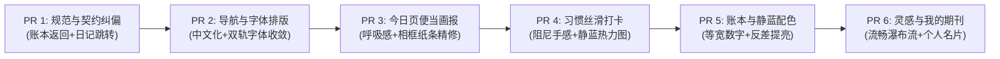

# 暖色生活志 · 前端视觉与交互升级提案

> **提案版本**：2026-10 升级演进版  
> **面向对象**：项目主人（日常使用「清简 · 静蓝」主题）  
> **编写原则**：用日常大白话阐述，少用晦涩专有名词，把视觉感受和交互手感讲透  
> **核心宪法**：严格遵守 `VISUAL_RULES.md`（暖色纸张画报系统规范）；绝不破坏已合入主干的四大硬性护栏。

---

## 零、不可退步的四条硬性护栏（绝对红线）

无论后续我们要把界面做得多么惊艳、多么顺滑，下面这四条规矩是**绝对不能退步的高压线**。它们已经在最近的主干（`main`）中完全修好并测试锁定。任何提案和后续改动，一旦踩到这四条，必须一票否决：

| 护栏序号 | 硬性护栏（不可退步） | 为什么绝不能碰（主人在意的体验） | 当前代码是怎么守住的 |
|---|---|---|---|
| **护栏 1** | **清简（plain）主题冷启动，不得先闪一下暖色纸** | 主人平时用的是清爽的清简蓝白主题。要是每次点开 App，屏幕先猛地闪一下米黄色的旧暖纸底，再跳成蓝白，眼睛会非常难受，感觉像破旧草稿纸在跳帧。 | `index.html` 在网页刚开始解析的第一毫秒，就通过轻量同步脚本查好主题，把底色锁死在冷雾蓝白 `#EAF0F8`，绝不给默认暖纸露头的机会。 |
| **护栏 2** | **照片绝对不能拉变形；横图竖图共用同一套相框，不要分两套** | 手机拍的照片有横有竖。以前竖图经常被拉伸变形、上下压扁；横图竖图各做一套相框又经常跳动。 | 统一采用 16:9 的专属相框：底层是同一张照片放大虚化作为优雅背景，表层是照片本尊原汁原味居中摆放。横图饱满、竖图自然露边，绝不拉伸一像素。 |
| **护栏 3** | **文字绝对不得压在照片画面底部** | 以前把拍照时间和文字直接印在照片下半截，遇到底色花哨或浅色照片，字根本看不清，还把好好的照片画面全挡住了。 | 文字全部移到照片正下方的独立纸条上：前面是清爽小巧的拍摄时间，后面是温润的手写体文字，字迹清晰透气，彻底还照片一片清净。 |
| **护栏 4** | **点击或打开视频时，绝对不能冒出突兀的白块** | 之前在手机上点按钮容易闪出系统白框；点开照片或视频转场时，屏幕会猛地泛出一块刺眼的纯白强光，极其刺眼。 | 动效层全面消除了 WebView 点击高亮，转场底色统一跟随页面纸色，视频元素自动跳过共享变形，并在视频第一帧画出来之前自动隐藏原生白底。 |

---

## 一、整体升级方向（用大白话讲）

我们这次升级的核心目标，不是推倒重来，也不是盲目跟风做那种冷冰冰、千篇一律的现代扁平大厂风，而是让 App：

> **从一个「功能齐全的电子记事本」，蜕变成一本「拿在手里舍不得放下、呼吸感十足的私人生活杂志画报」。**

具体体现在四个词：

1. **更丝滑（手感好）**：
   - 像在翻阅一本高级手账。手指按在按钮上，不是冷冰冰的硬切，而是有一种微微下沉的软弹阻尼；
   - 弹窗不再是“啪”的一声突兀弹出来吓人，而是像一张折叠纸条在指尖轻盈展开；
   - 左右滑动打卡、翻看照片时，像抹了黄油一样顺溜，没有卡顿与掉帧。
2. **更美观（养眼耐看）**：
   - 主人目前用的是**清简（静蓝）**主题。我们要把这种风格做到极致：**冷雾白的纸底 + 石板灰蓝的雅致文字 + 随手拍同款的主题蓝**，干净、通透、不脏、不发暗；
   - 告别黑乎乎的大黑块，也告别白茫茫一片分不清哪儿是卡片哪儿是背景的廉价感；每一张卡片都有柔和淡雅的微蓝边线和双层晨光投影。
3. **更大气（舒展有气度）**：
   - 版面不再挤挤挨挨。标题、正文、卡片之间的间距更讲究，留出恰到好处的“呼吸感”；
   - 核心主角（如今日画页、账本大字、习惯打卡）像杂志头条一样大大方方立在正中，次要信息安静退居其后，层次分明，一眼望去赏心悦目。
4. **更高级（细节见匠心）**：
   - 字体讲究：大标题和数字用端庄雅致的报刊衬线体（Newsreader），正文和生活感随笔用温润的手写文楷（LXGW WenKai），金额数字用等宽字体稳稳当当不跳动；
   - 每一个小印章、小纸签、小图标都恰如其分，像手工装订的一件生活艺术品。

---

## 二、页面优先级升级计划（从核心到子页）

我们按照主人每天使用频率从高到低，分五个主要页面梯队推进：

```
【第一梯队】今日页（Today）—— 每天打开第一眼
      ↓
【第二梯队】习惯页（Habits）—— 每天高频打卡与节奏
      ↓
【第三梯队】账本页（Ledger）—— 掌控日常收支与预算
      ↓
【第四梯队】灵感页（Moments）—— 随手拍与速记剪贴簿
      ↓
【第五梯队】我的页（Mine）—— 充满荣誉感的个人生活档案
      ↓
【关键子页】日记阅读、课程表、专注计时、书影音档案
```

---

### 第一梯队：今日页（Today）—— 杂志封面的第一眼惊艳

今日页是整个 App 的门面，主人每次冷启动打开看到的就是它。

- **现在感觉**：
  - 功能很全，但稍微有点紧凑，像一张填满了表格的日程纸；
  - 便当盒里的习惯、待办和今日课程挨得有点近，卡片与卡片之间的留白节奏不够舒展；
  - 顶部的天气、问候语和快速入口按钮稍显平铺，缺乏杂志封面的那种视觉张力。
- **升级后感觉**：
  - **画报式封面排头**：日期和问候语采用更有韵律的杂志版式，天气小插画与温度像一枚精致的邮戳点缀在右上角；
  - **画页相框更显档次**：严格保持横竖图同一套相框不拉伸，照片下方的时间与手写说明纸签做得更加细腻，像拍立得相纸底部精心写上的一行小字；
  - **便当盒（Bento Grid）呼吸感排版**：习惯打卡和待办事项拉开轻柔的呼吸间距，未完成与已完成的状态一目了然；
  - **快捷按钮像小纸签**：拍照、记一笔、AI 对话三个按钮做成质感轻盈的实体纸签，按下去有细腻的下沉微弹。

---

### 第二梯队：习惯页（Habits）—— 如丝顺滑的日常打卡器

习惯是每天都要互动的模块，好手感能让人心情愉悦。

- **现在感觉**：
  - 今日页便当卡里的滑动打卡稍微有点硬，手指滑过去的时候不太确定到底算不算完成；
  - 习惯详情里的年度打卡热力图在清简主题下，有的色块还是原来的深绿色，在冷蓝白底色上略显突兀；
  - 习惯成就勋章未达成的时候颜色较淡，达成之后缺乏一种被犒赏的仪式感。
- **升级后感觉**：
  - **滑动打卡软糯顺手**：手指从左往右轻轻一划，卡片像抽屉一样柔滑展开，滑到位的时候手机伴随一声微弱清脆的轻震，松手自动归位，手感极其上瘾；
  - **清简静蓝专属热力图**：热力图色块全面换成深浅递进的主题蓝调，像在高级手工纸上盖上深深浅浅的印章，一整年的坚持看起来清爽雅致；
  - **纸面成就勋章**：未达成的勋章像纸面上的凹版压纹，低调内敛；一旦打卡达成，勋章泛出温润的金蓝微光，仪式感拉满。

---

### 第三梯队：账本页（Ledger）—— 井井有条的黄铜夹账目

记账需要清晰、理智、可信赖。

- **现在感觉**：
  - 输入大额金额时，因为数字不是绝对等宽，按键时数字会左右微微晃动；
  - 快捷记账栏的分类按钮颜色较多，在清简主题下略微有点杂乱；
  - 账本分析页顶部的返回按钮被写成了“返回账本”，破坏了全 App 统一步调。
- **升级后感觉**：
  - **输入数字稳如磐石**：记账数字采用专门的等宽字体，输 10 块还是输 10000 块，数字原地生长，稳当不跳动；
  - **静蓝分类调和色**：常用支出分类按钮统一梳理，选中时呈现清爽的浅蓝底 + 蓝字，未选中时是纯白卡，视觉清爽不刺眼；
  - **严守规范的返回按钮**：彻底去掉冗余的“返回账本”，恢复成优雅的“返回”二字配左箭头，与全 App 二级页完全统一；
  - **票据夹式的收支流水**：每笔流水像整齐收纳在黄铜账夹里的机打小票，支出清晰、结余分明。

---

### 第四梯队：灵感页（Moments / 随手记）—— 心动时刻的剪贴簿

随手拍、速记、书影音的瀑布流。

- **现在感觉**：
  - 图片和视频卡片多了之后，快速滑动偶尔有轻微的滞涩感；
  - 日期分割条在向上滑动时，有时会和顶栏轻微打架；
  - 操作按钮（编辑、删除、查看）字号偏小，单手操作容易误触。
- **升级后感觉**：
  - **滑动如流水**：针对大图虚化底层做好图层加速，快速划动列表平滑无掉帧；横图、竖图、实况短视频全部安安稳稳坐在相框里，比例舒适；
  - **优雅吸顶纸条**：日期条向上滑动时，像一张磨砂薄纸轻轻停驻在顶栏下方，微微透出底下的图片色彩，过渡自然；
  - **大方好按的操作区**：编辑、删除和查看按钮间距优化，手指点按更从容。

---

### 第五梯队：我的页（Mine）—— 属于自己的生活档案馆

- **现在感觉**：
  - 像一个纯粹的系统设置列表，一排排选项略显严肃；
  - 顶部的累计专注、日记数等数据平铺展开，缺乏生活的自豪感。
- **升级后感觉**：
  - **个人专刊封面**：头像、昵称与格言重构为像杂志人物专栏一样的“个人封面卡”，带上优雅的呼吸背光；
  - **生活成就大字报**：累计专注时长、生活日记总数、打卡总天数做成精美的指标徽章卡片，一眼看到自己在这个 App 里留下的真实生活痕迹；
  - **清晰分区**：我的生活、智能设置、外观偏好、数据安全层级分明，设置背景清晰度时所见即所得。

---

### 关键子页升级看点

1. **日记阅读二级页**：
   - 保持“期刊装订拼贴”的专属身份，优化正文字号、行高与段间距，文字像印在细腻宣纸上一样易读，长文翻页像在读一本私人出版的小说。
2. **课程表二级页**：
   - 保留撕纸报头与五张 weekday 纸签的专属气质；周一到周日切换加上轻盈的位移过渡，正在上的课程有温和的静蓝高亮。
3. **专注计时页**：
   - 计时表盘外沿与清简背景的过渡更加柔和，倒计时过程中的光晕陪伴感更强、更安静，不分散专注力。
4. **全屏弹窗与表单体系**：
   - 在坚决不冒白块的前提下，让纯白弹窗带上从下方优雅升起并缓缓停住的物理弹簧过渡，告别硬生生的闪现。

---

## 三、「现在感觉 → 升级后感觉」全景对比表

| 场景 / 页面 | 现在感觉（日常痛点） | 升级后感觉（丝滑高级） | 遵循规矩与护栏保障 |
|---|---|---|---|
| **冷启动进入 App** | 清简主题有时心惊胆战，担心哪次又先闪一下米黄纸底 | 首帧即冷雾蓝白，干干净净，绝无暖纸闪烁，心里踏实稳定 | 严格执行护栏 1（解析期脚本 + early-theme-shell） |
| **今日画页浏览** | 照片虽然不拉伸了，但有时候文字和相框的留白稍微有点干瘪 | 相框大方稳重，底下时间与手写说明像拍立得纸条一样精致透气，横图竖图怎么看都顺眼 | 严格执行护栏 2 & 3（同一相框 + contain + 文字在照片下独立纸条） |
| **点开照片 / 视频** | 偶尔担心点快了屏幕闪出白块或 WebView 灰白高亮 | 点击处温润响应，转场如水流动，视频在首帧出来前安安静静，绝无突兀白闪 | 严格执行护栏 4（白块防御全面锁定） |
| **打开各种弹窗** | 弹窗有时硬生生跳出来，显得单薄生硬 | 弹窗像一张小纸片柔柔地从底部升起、吸附停驻，手感温和高级 | 保持浅色面防白块策略，补全 CSS 弹簧升起曲线 |
| **今日习惯滑动打卡** | 手指推过去感觉有点硬，不知道到底滑够了没有 | 像拉开带阻尼的抽屉，滑到位轻微一震，松手自动完成，极其丝滑爽快 | 新增轻触震动 + 对数弹性衰减阻尼 |
| **记账输入金额** | 按数字键盘时，金额数字左右晃动跳动 | 数字像石刻一样等宽排布，输多大金额都稳稳当当 | 严格启用 `ui-monospace` 字体契约 |
| **账本分析页顶栏** | 返回键写着“返回账本”，看起来啰嗦且不统一 | 纯净的 `arrow_back` + “返回”，端庄优雅，全 App 步调一致 | 彻底修复规范行 183 契约 |
| **清简文字小字阅读** | 浅灰色的日期和说明在室外或暗光下有点看不清，对比太弱 | 适度提深冷灰蓝阶，文字清晰锐利又保持静蓝优雅，阅读不费眼 | 遵循 WCAG AA 可读性标准 |
| **我的页生活成就** | 像一堆冷冰冰的数字和配置项开关 | 像一本记录了自己几百天时光的精美个人期刊，荣誉感与安心感满满 | 专属画报 Hero 卡重构 |

---

## 四、风险与兼容注意（防回退铁则）

升级过程必须严格遵守以下防护守则，任何一次改动都不能违背：

1. **绝对不得为了追求现代感而手画假装饰**：
   - 严禁为了所谓圆润而滥用 `border-radius: 28px` 大圆角卡片破坏经典主题的撕边；
   - 严禁使用 CSS 渐变伪造撕边、胶带或纸张厚度；所有装饰必须继续使用项目内置的高清 PNG 素材。
2. **六个二级页的专属素材一个都不能丢**：
   - 日记阅读的期刊装订、账本分析的黄铜夹、习惯档案的蕨叶标本、专注复盘的黄铜刻度、书影音的藏书票、课表的校园窗景，必须原汁原味保留专属气质，**统一绝对不能等于千篇一律**。
3. **每次改动必须做 5 档屏幕防溢出测试**：
   - 必须在 360px、395px、412px、540px、567px 宽度下逐一测试，保证横向溢出始终为 0（`Horizontal overflow = 0`），长文本必须带省略号截断。
4. **禁止修改数据结构底座**：
   - `model.js`、`storage.js`、`core.js` 的核心持久化逻辑一律不动，不新增未向主人报备的持久化顶层字段，确保真机本地数据安全无虞。

---

## 五、分阶段小 PR 实施计划

为了让主人对每一次改动都一清二楚、改动可追溯、体验可掌控，我们绝不搞一次性几千行代码的“大跃进式推倒重来”，而是拆分成**6 个小巧玲珑的分阶段 PR**。

每个 PR 都具备独立分支、纯中文详细说明，**必须主人亲自点头试用满意后，再合进 main**：



---

### PR 1：规范与契约快速纠偏（极小变动，秒级合入）
- **分支名称**：`fix/ia-ledger-return-and-subpage-contract`
- **中文目标**：把违反视觉宪法的明显不一致处彻底修好，对齐已定规矩。
- **改动范围**：
  1. `views/ledger.js`：删除行 618 手写“返回账本”，恢复规范标准“返回”；
  2. `views/journal.js` & `app.js`：日记过往篇章点击改为原地呼出日记阅读二级页，不再错跳日历；
  3. `styles.css`：清理行 1915 遗留的未内置字体 `Caveat`。
- **主人把关重点**：点击日记过往篇章是否顺畅阅读；账本分析返回按钮是否为端正的“返回”。

---

### PR 2：底部导航中文化与双轨字体收敛
- **分支名称**：`ui/dock-and-typography-warmth`
- **中文目标**：告别底栏纯英文，让主导航回归母语直观，字体完全回归画报双轨。
- **改动范围**：
  1. `core.js`：底栏 Dock 优化为中文主词「今日、日历、灵感、日记、账本」配微型 Newsreader 英文衬线字，中英合璧；
  2. `performance.css` & `styles.css`：收敛遗留的 `Inter` 回退，输入框与通用文本统一继承霞鹜文楷。
- **主人把关重点**：底部导航看起来是否大方雅致；文字读起来是否更加舒服。

---

### PR 3：今日页便当盒与模块呼吸感重构
- **分支名称**：`ui/today-bento-card-editorial`
- **中文目标**：今日页告别拥挤，便当盒卡片呼吸感升级，相框文字纸条更精致。
- **改动范围**：
  1. `views/today.js` & `styles.css`：优化便当盒网格间距、天气块与今日课程的留白节奏；
  2. 保持相框 100% 坚守护栏 2 和 3，进一步优化照片下方时间戳与文楷正文纸签的排版质感；
  3. 为浅色弹窗补充纯 CSS 轻量弹簧上升动效，告别硬切。
- **主人把关重点**：今日页整体看起来是否更舒展；弹窗打开是否变丝滑；四项护栏完全无退步。

---

### PR 4：习惯滑动打卡手感与静蓝热力图打磨
- **分支名称**：`ui/habits-smooth-swipe`
- **中文目标**：打卡手感如丝般顺滑，年度热力图完美融入清简静蓝。
- **改动范围**：
  1. `views/habits.js`：横向滑动打卡增加对数阻尼与达标轻微触感震动反馈；
  2. `themes-plain-light.css`：热力图色块全面改为蓝调阶梯，未达成勋章调整为雅致凹印纸面。
- **主人把关重点**：单手拇指划动打卡是否爽快利落；热力图在清简模式下是否清爽和谐。

---

### PR 5：账本等宽数字与清简静蓝色彩精修
- **分支名称**：`ui/ledger-and-plain-palette`
- **中文目标**：记账数字稳当不跳动，清简文字对比度达标不费眼。
- **改动范围**：
  1. `views/ledger.js` & `styles.css`：金额大字强制应用 `ui-monospace`，快速记账分类按钮统一清简蓝白配色；
  2. `themes.css`：调深清简主题的 `--ink-muted`（从 `#98A1AD` 优化至 `#7E8896`），小字小标对比度全面达标。
- **主人把关重点**：输入任意大额数字是否完全不晃动；暗光下小字和日期是否清晰好读。

---

### PR 6：灵感瀑布流提速与我的页生活期刊化
- **分支名称**：`ui/snippets-and-mine-magazine`
- **中文目标**：随手拍大列表划动如流水，我的页蜕变为主人的生活专刊封面。
- **改动范围**：
  1. `views/snippets.js` & `styles.css`：相册流大图图层加速，日期吸顶条轻柔磨砂化；
  2. `views/mine.js`：个人卡片增加光晕呼吸与专栏杂志感，KPI 勋章化，设置项模块更加明晰。
- **主人把关重点**：连续快速滑动随手拍是否流畅如飞；我的页面是否更有生活仪式感。

---

*提案撰写完毕。本案严格秉承主人制定的 VISUAL_RULES 宪法，全力守护四大硬性护栏，静候主人审阅与推进指令。*
